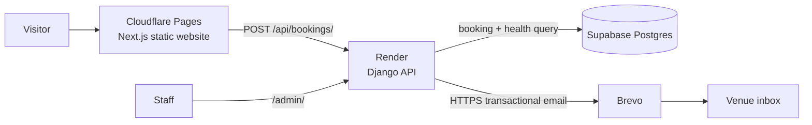

# Lumi Lane

Project source for the Lumi Lane website and booking backend. The repository is split into two deployable applications:

```text
lumi-lane/
├── website/    Next.js static export → Cloudflare Pages
└── backend/    Django API + admin → Render Web Service
               PostgreSQL database → Supabase
```



The current website accepts **table reservation requests**. Django saves each request in Supabase and sends a notification to the venue through Brevo's HTTPS API. A saved request is not an automatically confirmed reservation; staff confirm it from the admin page or by contacting the guest.

## Local development

Requirements: Node.js 20.19+ and Python 3.12.

Commands are available from the repository root through GNU Make (Git Bash on Windows):

```bash
make help             # list commands
make install          # install Python and Node dependencies
make migrate          # apply local SQLite migrations
make run              # run Django at 127.0.0.1:8000
make website          # run Next.js at localhost:3000 (another terminal)
make superuser        # create a local Django admin account
make seed_data        # load sample bookings for the admin preview
```

`make seed_data` only writes to DEBUG + local SQLite, is safe to run repeatedly, and never sends emails. In Django admin, sample records use `example.com` addresses and include new, contacted, confirmed, cancelled, and email-failed states.

The definitions live in `scripts/Makefile`; the root `Makefile` includes them. Django commands automatically use `backend/.venv` when it exists.

### Backend

```powershell
cd backend
py -3.12 -m venv .venv
.venv\Scripts\Activate.ps1
pip install -r requirements.txt
Copy-Item .env.example .env
python manage.py migrate
python manage.py createsuperuser
python manage.py runserver
```

Without `DATABASE_URL`, Django uses `backend/db.sqlite3`. Local email uses Django's console backend, so it prints a preview in the terminal and never contacts Brevo. The API health check is [http://127.0.0.1:8000/health/](http://127.0.0.1:8000/health/) and the admin is [http://127.0.0.1:8000/admin/](http://127.0.0.1:8000/admin/).

### Website

```powershell
cd website
npm ci
Copy-Item .env.example .env.local
npm run dev
```

The example frontend URL points to the local Django server. Open [http://localhost:3000/book/](http://localhost:3000/book/) to submit a test request.

## Deployment

### 1. Supabase

Create a Supabase project, then copy its PostgreSQL **Session pooler** connection string from **Connect**. Use the `:5432` session-pooler endpoint for this long-running Django/Gunicorn service. Keep the connection string private and set it as Render's `DATABASE_URL`. The backend applies Django migrations during each Render build.

### 2. Render backend

Create a Web Service from this repository using `backend/render.yaml` (or configure the service manually with root directory `backend`). Set the following environment variables in Render:

| Variable | Value |
| --- | --- |
| `DATABASE_URL` | Supabase session-pooler URL |
| `DJANGO_ALLOWED_HOSTS` | `your-service.onrender.com` and any API custom domain, comma-separated |
| `CORS_ALLOWED_ORIGINS` | Cloudflare production origin, e.g. `https://your-site.pages.dev` |
| `CSRF_TRUSTED_ORIGINS` | Same HTTPS website origin(s) |
| `BREVO_API_KEY` | Brevo API v3 key |
| `DEFAULT_FROM_EMAIL` | Sender address verified in Brevo, e.g. `Lumi Lane <bookings@your-domain.com>` |
| `BOOKING_NOTIFICATION_EMAIL` | Venue inbox that receives booking alerts |
| `PUBLIC_BACKEND_URL` | Render public URL, e.g. `https://your-service.onrender.com` |

`DJANGO_SECRET_KEY` is generated by the Render blueprint. Set `DJANGO_DEBUG=false`. Render's HTTP health check is `/health/`, which runs `SELECT 1` against the configured database and returns `503` if the database is unavailable.

The booking record is committed before Brevo is called. If email delivery fails, the request remains available in Django admin with the notification status marked as failed. The API uses a request UUID so a network retry does not create another booking.

### 3. Cloudflare Pages website

Import the repository into Cloudflare Pages and set the project root directory to `website`. Use the **Next.js (Static HTML Export)** preset, build command `npm run build`, and output directory `out`. Add this Pages environment variable for production builds:

```text
NEXT_PUBLIC_API_BASE_URL=https://your-service.onrender.com
```

Add the deployed Pages origin to `CORS_ALLOWED_ORIGINS` and `CSRF_TRUSTED_ORIGINS` on Render. For local development, `.env.local` uses `http://127.0.0.1:8000`.

### 4. Admin account

After deployment, run Django's `createsuperuser` management command from a trusted local checkout with `DATABASE_URL` temporarily set to the same Supabase connection string, then sign in at `https://your-service.onrender.com/admin/`. Never commit that URL. The admin can search requests, update their reservation status, see whether the email notification was sent, and retry failed email notifications.

## Keeping the Render free service responsive

Render Free sleeps after 15 minutes without inbound traffic. Configure an uptime monitor to request `https://your-service.onrender.com/health/` every five minutes. Each request also checks Supabase with a lightweight query. The Render blueprint health check helps Render detect an unhealthy running instance; the external five-minute monitor is what supplies regular inbound traffic while the service is idle.

Free services have a shared allowance of 750 running hours per workspace per month, can restart at any time, and have ephemeral local filesystems. The five-minute monitor usually keeps a single service running within that allowance, but other free services in the same workspace consume it too. Supabase Free can pause an inactive database project, so the health query helps only while the API itself is awake. Treat the free setup as a low-cost prototype, not a production uptime guarantee.

## Data and secrets

- Do not commit `.env`, `.env.local`, database URLs, the Brevo API key, or production Django secrets.
- Production data is stored in Supabase. Render's local filesystem is not used for booking persistence.
- Keep the Supabase service database credential on the backend only; the website calls Django and never connects directly to Postgres.
- Keep a database export/backup before changing schemas or deleting the Supabase project.
