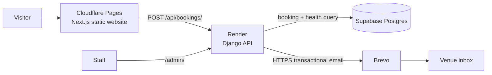

# Lumi Lane

Project source for the Lumi Lane website and booking backend. The repository is split into two deployable applications:

```text
lumi-lane/
├── website/    Next.js static export → Cloudflare Pages
└── backend/    Django API + admin → Render Web Service
               PostgreSQL database → Supabase
```



The current website accepts **table reservation requests**. Django saves each request in Supabase and sends a notification to the venue through Brevo's HTTPS API. A saved request is not an automatically confirmed reservation; staff confirm it from the admin page or by contacting the guest.

## Menu (managed on the server)

The menu (tabs, sections, items, prices, wine glass/bottle prices, the açai price table) lives in Django: **Admin → Menu → Items & prices** is the everyday screen, with prices and availability editable straight from the list. `GET /api/menu/` serves it as JSON (cached 60 s). Unticking *Available* hides an item; a section whose items are all unavailable is hidden too.

The website shows it in two layers:

1. `npm run build` first runs `scripts/fetch-menu.mjs`, which copies `/api/menu/` into `website/src/data/menu-snapshot.json`; the static `/menu/` HTML is built from that file. If the API cannot be reached, the build keeps the existing snapshot. Run `npm run menu:pull` to refresh it by hand, and commit it when it changes.
2. In the browser, `/menu/` then loads the live menu from the API and swaps it in, so a price change shows within about a minute without rebuilding. If the API is asleep or down, visitors keep seeing the built-in menu.

A new database gets the original menu from the `menu.0002_seed_menu` migration (data in `backend/menu/data/initial_menu.json`). Prices print per tab: *$25.9* style (Brunch, Açai) or *4.20* style (Coffee & Drinks, Bar), set on each menu tab.

## Local development

Requirements: Node.js 20.19+ and Python 3.12.

Commands are available from the repository root through GNU Make (Git Bash on Windows):

```bash
make help             # list commands
make install          # install Python and Node dependencies
make migrate          # apply local SQLite migrations
make run              # run Django at 127.0.0.1:8000
make website          # run Next.js at localhost:3000 (another terminal)
make superuser        # create a local Django admin account
make seed_data        # load sample bookings for the admin preview
```

`make seed_data` only writes to DEBUG + local SQLite, is safe to run repeatedly, and never sends emails. In Django admin, sample records use `example.com` addresses and include new, contacted, confirmed, cancelled, and email-failed states.

The definitions live in `scripts/Makefile`; the root `Makefile` includes them. Django commands automatically use `backend/.venv` when it exists.

### Backend

```powershell
cd backend
py -3.12 -m venv .venv
.venv\Scripts\Activate.ps1
pip install -r requirements.txt
Copy-Item .env.example .env
python manage.py migrate
python manage.py createsuperuser
python manage.py runserver
```

`backend/.env` (local) and `backend/.env.prod` (production) follow `backend/.env.example` line for line. Django reads `.env`; set `DJANGO_ENV_FILE=.env.prod` (or add `env=prod` to a make command, e.g. `make superuser env=prod`) to run a command with the production file. With `DATABASE_URL` empty, Django uses `backend/db.sqlite3`. Local email uses Django's console backend, so it prints a preview in the terminal and never contacts Brevo. The API health check is [http://127.0.0.1:8000/health/](http://127.0.0.1:8000/health/) and the admin is [http://127.0.0.1:8000/admin/](http://127.0.0.1:8000/admin/).

### Website

```powershell
cd website
npm ci
Copy-Item .env.example .env.local
npm run dev
```

The example frontend URL points to the local Django server. Open [http://localhost:3000/book/](http://localhost:3000/book/) to submit a test request.

## Deployment

### 1. Supabase

Create a Supabase project, then copy its PostgreSQL **Session pooler** connection string from **Connect**. Use the `:5432` session-pooler endpoint for this long-running Django/Gunicorn service. Keep the connection string private and set it as Render's `DATABASE_URL`. The backend applies Django migrations during each Render build.

### 2. Render backend

Create a Web Service from this repository using `backend/render.yaml` (or configure the service manually with root directory `backend`). Set the following environment variables in Render:

| Variable | Value |
| --- | --- |
| `DATABASE_URL` | Supabase session-pooler URL |
| `DJANGO_ALLOWED_HOSTS` | `your-service.onrender.com` and any API custom domain, comma-separated |
| `CORS_ALLOWED_ORIGINS` | Cloudflare production origin, e.g. `https://your-site.pages.dev` |
| `CSRF_TRUSTED_ORIGINS` | Same HTTPS website origin(s) |
| `BREVO_API_KEY` | Brevo API v3 key |
| `DEFAULT_FROM_EMAIL` | Sender address verified in Brevo, e.g. `Lumi Lane <bookings@your-domain.com>` |
| `BOOKING_NOTIFICATION_EMAIL` | Venue inbox that receives booking alerts |
| `PUBLIC_BACKEND_URL` | Render public URL, e.g. `https://your-service.onrender.com` |

`DJANGO_SECRET_KEY` is generated by the Render blueprint. Set `DJANGO_DEBUG=false`. Render's HTTP health check is `/health/`, which runs `SELECT 1` against the configured database and returns `503` if the database is unavailable.

The booking record is committed before Brevo is called. If email delivery fails, the request remains available in Django admin with the notification status marked as failed. The API uses a request UUID so a network retry does not create another booking.

### 3. Cloudflare Pages website

Import the repository into Cloudflare Pages and set the project root directory to `website`. Use the **Next.js (Static HTML Export)** preset, build command `npm run build`, and output directory `out`. Add this Pages environment variable for production builds:

```text
NEXT_PUBLIC_API_BASE_URL=https://your-service.onrender.com
```

Add the deployed Pages origin to `CORS_ALLOWED_ORIGINS` and `CSRF_TRUSTED_ORIGINS` on Render. For local development, `.env.local` uses `http://127.0.0.1:8000`.

### 4. Admin account

After deployment, fill in `backend/.env.prod` (including `DATABASE_URL`) and run `make superuser env=prod` from a trusted local checkout, then sign in at `https://your-service.onrender.com/admin/`. Never commit that file.

### Apple Wallet member cards

Register a Pass Type ID and issue its signing certificate in the Lumi Lane Apple Developer account. Configure the Render API with `WALLET_PASS_TYPE_ID`, `WALLET_TEAM_ID`, and secret files containing the PEM signing certificate, private key and matching Apple WWDR intermediate. Set `WALLET_CERT_FILE`, `WALLET_KEY_FILE` and `WALLET_WWDR_FILE` to their absolute paths. Set `WALLET_KEY_PASSWORD` as a secret if the key is encrypted. Enable the existing website origin in `CORS_ALLOWED_ORIGINS`. Once the API is deployed, open Coffee Club in Safari on an iPhone, register and tap **Add to Apple Wallet** to verify the signed pass. The pass identifies the member and does not carry demo stamps.

The admin is English (Australia) only and shows Adelaide time. Besides table requests and the menu, **Team** holds staff accounts and roles:

- Four ready-made roles are created on the first `migrate`: **Manager**, **Front of house**, **Menu editor** and **View only**. They are only created when missing, so edits made in the admin are kept.
- Permissions are shown as a table of areas (Table requests, Menu items & prices, Staff accounts…) by action (View, Add, Edit, Delete) instead of Django's raw permission names.
- A team member needs **Can sign in to the admin** ticked plus at least one role. **Owner (full access)** is the superuser flag.

## Keeping the Render free service responsive

Render Free sleeps after 15 minutes without inbound traffic. Configure an uptime monitor to request `https://your-service.onrender.com/health/` every five minutes. Each request also checks Supabase with a lightweight query. The Render blueprint health check helps Render detect an unhealthy running instance; the external five-minute monitor is what supplies regular inbound traffic while the service is idle.

Free services have a shared allowance of 750 running hours per workspace per month, can restart at any time, and have ephemeral local filesystems. The five-minute monitor usually keeps a single service running within that allowance, but other free services in the same workspace consume it too. Supabase Free can pause an inactive database project, so the health query helps only while the API itself is awake. Treat the free setup as a low-cost prototype, not a production uptime guarantee.

## Data and secrets

- Do not commit `.env`, `.env.local`, database URLs, the Brevo API key, or production Django secrets.
- Production data is stored in Supabase. Render's local filesystem is not used for booking persistence.
- Keep the Supabase service database credential on the backend only; the website calls Django and never connects directly to Postgres.
- Keep a database export/backup before changing schemas or deleting the Supabase project.
